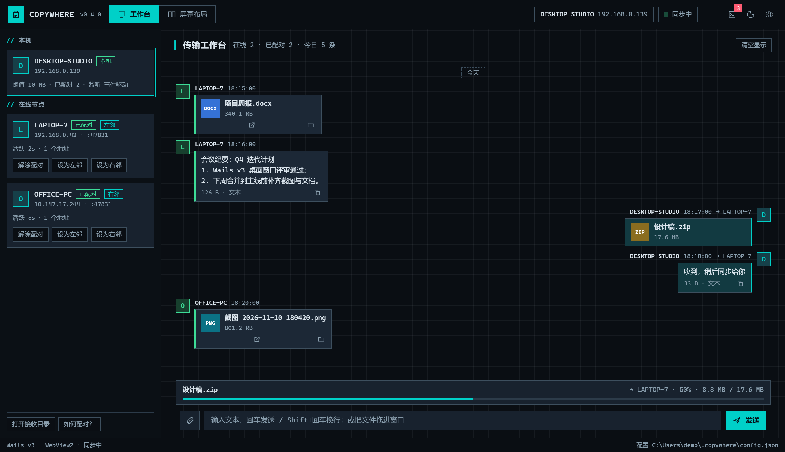
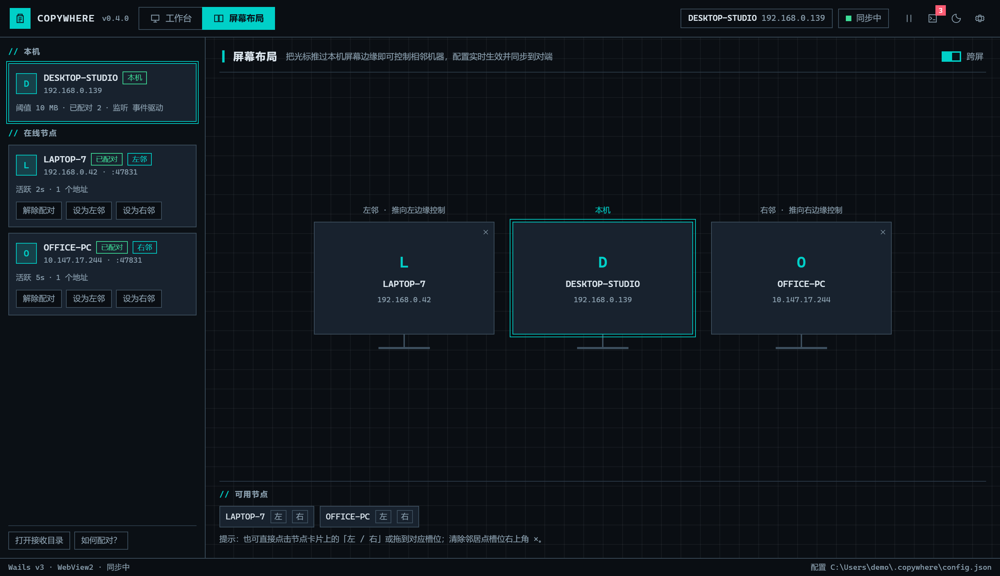
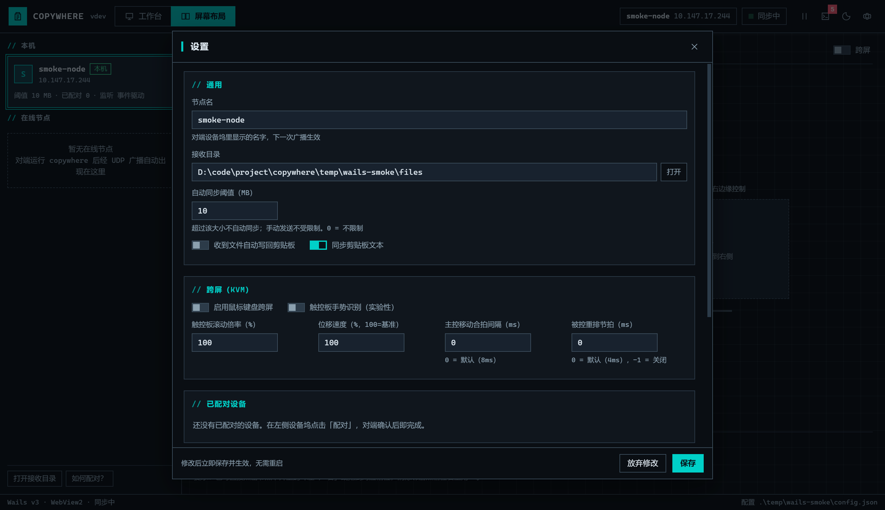

# Wails v3 桌面窗口

> 基线：`78a5626`（v0.4.0），并已合并 `main` 的 v0.5.0（右键发送、KVM 边缘死区、
> doctor、低完整性保护等）。本分支（`feat/wails-ui`）用 Wails v3 桌面窗口替代了
> 历史上的浏览器面板（`gui` + `internal/webui` + `fyne.io/systray`）和终端三页
> TUI（`internal/ui`），**只保留一种 UI**：双击 exe 打开的桌面窗口。
> 状态：可运行、可构建、有单测；尚未并入发布流水线。

## 1. 为什么做、做了什么

网页面板的痛点不在功能，而在「承载」：浏览器标签页身份错位、Alt+Tab 混在网页里、
关掉标签页服务还在跑、二次双击只多开一个标签页。Wails v3 提供的是 L1 级
「独立应用窗口 + WebView2 + 原生托盘/菜单/对话框」，正好覆盖这些痛点，
同时保留 Web 前端在富交互（时间线、布局画布、灯箱）上的成本优势。

本分支因此**不重写核心**，只保留一个桌面壳与新前端，并删除了两套冗余 UI：

- 完整复用 `internal/app`（发现/传输/剪贴板/KVM）、`internal/config`、`internal/record`；
- 新增 `internal/panel`（共享层：事件总线、配置应用、图标、Shell 辅助）；
- 新增 `internal/wailsui`：Wails 应用装配、绑定服务、事件桥、托盘、窗口生命周期；
- 新增 `internal/wailsui/frontend`：不依赖 Node/npm 的静态 HTML/CSS/JS，
  沿用旧面板的 WIREFRAME / TERMINAL 视觉（等宽字体、1px 线框、终端配色、深浅双主题）；
- 删除 `internal/webui`（HTTP/SSE 面板、浏览器打开、`fyne.io/systray` 托盘、
  内嵌 `index.html`）与 `internal/ui`（bubbletea TUI），依赖从 30+ 收敛到
  `wails/v3` + `x/sys` 两条直接依赖。

## 2. 目录结构与职责

```
cmd/copywhere/
  main.go              # 无参数 → 桌面窗口；run 为无窗口服务；其余 CLI 子命令
  wails.go             # 单实例、日志落盘、启动/收尾（不再有 HTTP 面板）
internal/wailsui/
  app.go               # Wails 应用装配：窗口、托盘、事件桥、拖放、尺寸记忆、退出
  service.go           # 绑定给前端的 Service（视图 + 操作），Core 接口便于测试
  util.go              # 图片预览白名单 / base64
  activate_windows.go  # 二次启动兜底：枚举窗口 + 校验同 exe 名后唤回
  frontend/            # index.html + app.css + app.js（go:embed）
internal/panel/
  bus.go               # 事件总线（日志/记录/进度/配对请求）
  config_apply.go      # ApplyConfig：设置页唯一入口（校验 + 落盘 + 热更新）
  core.go              # 配置应用依赖的核心能力接口
  icons.go / reveal.go # 应用图标、资源管理器定位
internal/ipc/            # 命名管道：右键发送 / 二次唤起（替代 HTTP 面板地址）
internal/shellmenu/      # 资源管理器右键菜单注册（HKCU 静态动词）
internal/record/
  record.go            # 收发记录视图（核心与桌面窗口共用）
```

## 3. 通信模型

- **前端 → Go**：`Call.ByName("copywhere/internal/wailsui.Service.<Method>", ...)`
  （FQN 由包路径 + 类型名生成，`service_test.go` 锁死该值与关键方法）。
- **Go → 前端**：
  - `cw:event`：与共享事件总线同构的 `{type, data}`（`log` / `file` / `progress` /
    `pair_request`），由 `panel.Bus` 转发。
  - `cw:toast`：轻提示（拖放投送结果、操作失败原因）。
  - `peers` / `state`：每 2 秒由 Service 以 camelCase 视图推送。
- **拖放**：窗口开启 `EnableFileDrop`，Go 端监听 `WindowFilesDropped` 拿到真实路径，
  直接 `core.SendFiles(paths, 0)`；前端只负责高亮与提示。
- **配置**：`SaveSettings` → `panel.ApplyConfig`，完成校验、落盘与热更新
  （KVM 启停、触控板手势、邻居同步）。

## 4. 生命周期

| 事项 | 行为 |
| --- | --- |
| 关闭按钮 | `WindowClosing` 钩子里 `Hide()` + `Cancel()`，进程与同步继续，托盘常驻 |
| 托盘 | 打开窗口 / 自动同步复选框 / 打开接收目录 / 退出；左键打开菜单 |
| 退出 | 标记 quitting → 保存窗口尺寸 → 取消核心上下文 → `app.Quit()`；宿主随后 `Wait()` |
| 二次启动 | 命名互斥锁拦截 → 枚举「WailsWebviewWindow + 标题 + 同 exe 名」窗口，`SW_RESTORE` + 置前 |
| 尺寸记忆 | 拖动/缩放 400ms 去抖落盘 `~/.copywhere/wails-window.json`，启动恢复尺寸、位置居中 |
| 单实例 | 与 `run` 共用 `Local\copywhere-singleton`；没有本地 HTTP 端口，也不再有浏览器回退 |

## 5. 前端功能

- 工作台：今天/昨天/日期分组；左收右发气泡；文本展开/复制；文件类型徽标卡片；
  接收目录图片缩略图 + 灯箱；失败状态着色；实时进度条；清空显示（不影响对端）。
- 设备坞：本机卡片（阈值/已配对/监听方式）、在线节点（地址/活跃/配对/鉴权拒绝/
  左右邻标签）、配对/解除/设为左邻右邻。
- 屏幕布局：左邻 / 本机 / 右邻三屏画布，拖拽或点选配置，清除按钮；跨屏总开关。
- 设置：节点名、接收目录、阈值、自动回贴、文本同步、跨屏开关、触控板手势与倍率、
  移动合拍/重排节拍/速度、已配对设备管理、主题、关于（版本/配置/端口/监听方式）。
- 日志抽屉：`Ctrl+L` 开关、错误行着色、未读角标、复制、清空（仅本窗口）。
- 快捷键：`Ctrl+K` 聚焦输入、`Ctrl+,` 设置、`Enter` 发送、`Shift+Enter` 换行、
  `Esc` 关闭弹层（配对确认不响应 Esc，须明确裁决）。

## 6. 界面预览

工作台（对话式时间线、设备坞、实时进度、日志角标）：



屏幕布局（左邻 / 本机 / 右邻，拖拽或点选配置，即时同步对端）：



设置（`panel.ApplyConfig`，保存即生效）：



> 截图由 CDP（`CW_WAILS_DEBUG_PORT`）对真实窗口截取，其中节点名/IP/记录为演示数据。

## 7. 构建与运行

要求：Go 1.26.4+（与 go.mod 一致）、Windows 10 1803+ / Windows 11、系统 WebView2
运行时。Wails 依赖固定为 `github.com/wailsapp/wails/v3 v3.1.0`，Windows 构建不需要 CGO。
发布构建实测 13,272,576 B（v0.4.0 基线 9,192,448 B，+3.9 MiB：Wails 运行时、
WebView2 宿主与 v0.5.0 新增的 IPC/右键菜单代码，不含系统 WebView2 本身）。

```powershell
# 开发构建（控制台可见，便于看日志）
go build -o copywhere.exe ./cmd/copywhere
copywhere.exe                 # 双击/无参数 → 桌面窗口
copywhere.exe wails           # 显式子命令（等价）

# 发布构建
go build -trimpath -ldflags "-s -w -H windowsgui -X copywhere/internal/app.Version=v0.4.0-wails" `
  -o copywhere.exe ./cmd/copywhere
```

冒烟测试（自动退出，隔离端口，可与本机正在运行的实例并存）：

```powershell
copywhere.exe wails -config .\smoke-config.json -smoke 8s
# 退出时会把事件总线日志打到控制台/日志文件：[smoke] ...
```

调试：设置 `CW_WAILS_DEBUG_PORT=9222` 后可用 CDP 连接 WebView2
（`http://127.0.0.1:9222/json/list`）截图或排查前端；`CW_WAILS_DEVTOOLS=1` 启动即打开
开发者工具。

运行时日志写入 `~/.copywhere/gui.log`（超过 4MB 清空重来）：服务启动后
`app.Options.LogFile` 让日志同时进入事件总线与磁盘，窗口崩溃/闪退也有据可查。

## 8. 验证记录（本机实测）

- `go build ./...`、`go vet ./internal/wailsui ./internal/panel ./cmd/copywhere` 通过。
- `go test ./...` 全绿；`go test -race ./internal/wailsui` 通过。
- `internal/wailsui` 覆盖：状态/节点视图、发送校验、设置保存与落盘、
  KVM 邻居、配对流程、图片预览安全边界、事件桥、绑定 FQN；
  `internal/panel` 覆盖：配置校验、落盘、热更新与旧邻居传递。
- 冒烟日志确认链路：`[WebView2] Environment created successfully` →
  `Wails 桌面窗口已启动` → `Wails 前端已加载：<UA>` → 自动退出 `err=<nil>`。
- CDP 实测：设置保存后 Go 端 `State().nodeName` 同步变化并落盘；
  `SetKVMNeighbor` 后 `State().kvmLeft` 生效；无节点发送文本返回可读错误。
- 端口实测：冒烟运行期间只监听传输端口（47851/tcp），**没有**旧的 47890 面板端口；
  `run` 无窗口模式下日志正常输出、剪贴板监控启动。
- IPC 实测：`copywhere shell-send <文件>` 经命名管道把路径交给运行中的窗口实例，
  无节点时返回可读错误（而不是「未运行」）；`copywhere doctor` 能识别 IPC 可用、
  端口监听与 WebView2 版本。
- Win32 实测：`WM_CLOSE` 后窗口隐藏、进程存活；二次启动约 200ms 内恢复原窗口并退出 0。

## 9. 已知限制与后续

1. **仅 Windows**：核心服务本身就是 Windows 专用；Wails 窗口未做 Linux/macOS 适配。
2. **依赖 WebView2 运行时**：企业精简镜像/LTSC 需预装；缺失时窗口无法创建。
3. **绑定 FQN 硬编码**：前端使用 `Call.ByName`，避免引入 `wails3` CLI 生成绑定；
   若模块名或包路径变化，需同步 `app.js` 中的常量（有单测守护）。
4. **无前端工程化**：没有 Node 构建、HMR、打包压缩；换来的是 `go build` 单命令。
5. **只保留一种 UI**：`run` 退化为无窗口日志服务，不再提供 TUI；需要界面时必须
   在交互式桌面会话中运行 `copywhere`/`copywhere wails`。
6. **右键发送/二次唤起依赖窗口实例**：都走本机命名管道；终端 `run` 模式没有窗口
   IPC，右键会提示先以窗口模式启动。
7. **未接入发布**：`.github/workflows/build.yml`、`docs/release.md` 未包含 Wails 产物；
   `wails3` CLI 的 manifest/图标/绑定生成流程也未接入。
8. **二次唤回的主路径是 IPC**（按登录会话的命名管道）；管道不可用时退回「同 exe 名
   + 窗口类 + 标题」枚举。若 exe 改名且 IPC 又不可用，第二次启动只会提示已有实例。
