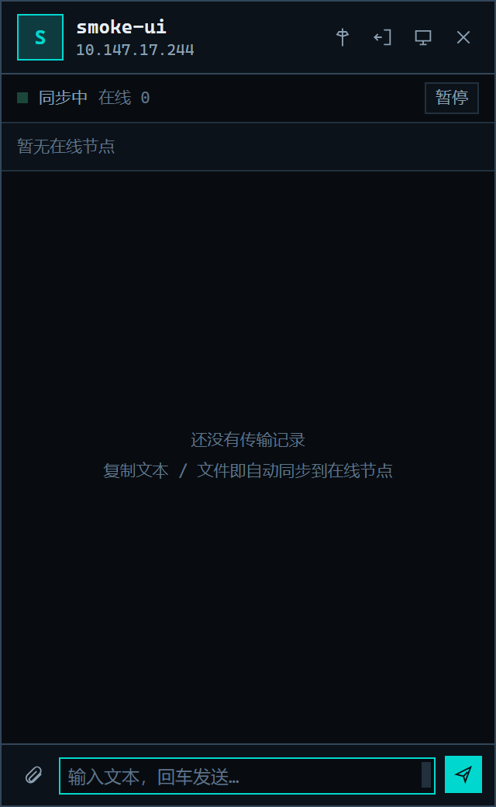

# Wails v3 桌面窗口

> 基线：`78a5626`（v0.4.0），并已合并 `main` 的 v0.5.0（右键发送、KVM 边缘死区、
> doctor、低完整性保护等）；自 **v0.6.0** 起随 `main` 发布。用 Wails v3 桌面窗口替代了
> 历史上的浏览器面板（`gui` + `internal/webui` + `fyne.io/systray`）和终端三页
> TUI（`internal/ui`），**只保留一种 UI**：双击 exe 打开的桌面窗口。
> 状态：已发布（v0.6.0），可运行、可构建、有单测。

## 1. 为什么做、做了什么

网页面板的痛点不在功能，而在「承载」：浏览器标签页身份错位、Alt+Tab 混在网页里、
关掉标签页服务还在跑、二次双击只多开一个标签页。Wails v3 提供的是 L1 级
「独立应用窗口 + WebView2 + 原生托盘/菜单/对话框」，正好覆盖这些痛点，
同时保留 Web 前端在富交互（时间线、布局画布、灯箱）上的成本优势。

本分支因此**不重写核心**，只保留一个桌面壳与新前端，并删除了两套冗余 UI：

- 完整复用 `internal/app`（发现/传输/剪贴板/KVM）、`internal/config`、`internal/record`；
- 新增 `internal/panel`（共享层：事件总线、配置应用、图标、Shell 辅助）；
- 新增 `internal/wailsui`：Wails 应用装配、绑定服务、事件桥、托盘、窗口生命周期；
- 新增 `internal/wailsui/frontend`：不依赖 Node/npm 的静态 HTML/CSS/JS，
  沿用旧面板的 WIREFRAME / TERMINAL 视觉（等宽字体、1px 线框、终端配色、深浅双主题）；
- 删除 `internal/webui`（HTTP/SSE 面板、浏览器打开、`fyne.io/systray` 托盘、
  内嵌 `index.html`）与 `internal/ui`（bubbletea TUI），依赖从 30+ 收敛到
  `wails/v3` + `x/sys` 两条直接依赖。

## 2. 目录结构与职责

```
cmd/copywhere/
  main.go              # 无参数 → 桌面窗口；run 为无窗口服务；其余 CLI 子命令
  wails.go             # 单实例、日志落盘、启动/收尾（不再有 HTTP 面板）
internal/wailsui/
  app.go               # Wails 应用装配：窗口、托盘、事件桥、拖放、退出
  service.go           # 绑定给前端的 Service（视图 + 操作），Core 接口便于测试
  uimode.go            # 标准/简约模式常量、UiState、窗口几何（纯函数，可单测）
  window.go            # 窗口控制器：切模式/置顶/吸边收起/尺寸与偏好持久化
  window_style_windows.go # 吸边图标所需的原生样式位（去标题栏、拖动松手检测）
  window_style_other.go   # 非 Windows 空实现
  util.go              # 图片预览白名单 / base64
  activate_windows.go  # 二次启动兜底：枚举窗口 + 校验同 exe 名后唤回
  frontend/            # index.html + app.css + app.js（go:embed）
internal/panel/
  bus.go               # 事件总线（日志/记录/进度/配对请求）
  config_apply.go      # ApplyConfig：设置页唯一入口（校验 + 落盘 + 热更新）
  core.go              # 配置应用依赖的核心能力接口
  icons.go / reveal.go # 应用图标、资源管理器定位
internal/ipc/            # 命名管道：右键发送 / 二次唤起（替代 HTTP 面板地址）
internal/shellmenu/      # 资源管理器右键菜单注册（HKCU 静态动词）
internal/record/
  record.go            # 收发记录视图（核心与桌面窗口共用）
```

## 3. 通信模型

- **前端 → Go**：`Call.ByName("copywhere/internal/wailsui.Service.<Method>", ...)`
  （FQN 由包路径 + 类型名生成，`service_test.go` 锁死该值与关键方法）。
- **Go → 前端**：
  - `cw:event`：与共享事件总线同构的 `{type, data}`（`log` / `file` / `progress` /
    `pair_request`），由 `panel.Bus` 转发。
  - `cw:toast`：轻提示（拖放投送结果、操作失败原因）。
  - `cw:ui`：界面模式快照（标准/简约、是否吸边收起、边缘、置顶），由窗口控制器在
    模式变化时推送；前端启动时另用 `UiState` 读一次。
  - `peers` / `state`：每 2 秒由 Service 以 camelCase 视图推送。
- **界面模式绑定**：`UiState` / `SetUiMode(mini|standard)` / `SetAlwaysOnTop(bool)` /
  `SetCollapsed(bool)` / `HideWindow`；几何与落盘都在 `windowController`，前端只切外壳。

- **拖放**：窗口开启 `EnableFileDrop`，Go 端监听 `WindowFilesDropped` 拿到真实路径，
  直接 `core.SendFiles(paths, 0)`；前端只负责高亮与提示。
- **粘贴投送**：输入框的 `paste` 事件只当触发器——网页拿不到剪贴板文件的真实路径，
  由 `Service.PasteFiles()` 在 Go 端读系统剪贴板（`clip.ReadFiles`，即 `CF_HDROP`），
  再走与拖放相同的 `SendFiles` 链路，无需先上传临时文件。剪贴板里带文本
  （`text/plain`/`text/html`，含 Excel/Word 复制时附带的位图预览组合）时一律放行给
  浏览器默认粘贴，只有"文件"粘贴才被接管，避免吞掉文本；Go 侧没有文件时静默不发
  （该分支下剪贴板也没有可插入的文本）。连按 `Ctrl+V` 有 in-flight 保护，不会并发重复投送。
  返回值为实际可发送的条目数（已过滤不存在/空的路径）；发送失败才报错。
  注意：粘贴是**手动发送语义**（不受自动同步阈值与暂停状态限制），所以这批文件若刚被
  自动同步发过，对端会再收到一份——这正是"超过阈值/已暂停时手动补发"的入口。
- **命令行委派（v0.6.0）**：`send` 在检测到窗口实例时不再自己监听，而是通过管道
  `send-job` / `send-text` 建任务（校验路径与可投递节点后立即返回任务 id），
  窗口实例在独立 goroutine 里用 `App.SendFilesWithResult` 发送，并把每个对端的
  `{peer, ok, retry, msg}` 写回任务快照。命令行默认只打印「已受理，任务 <id>」，
  用 `copywhere status <id>` 取逐对端结果与汇总；加 `-wait-result` 才每 150ms 轮询
  `job` 直到完成（有致命失败退出码 1）。默认即返是为了避开 GUI 子系统进程在
  PowerShell 里"输出落在提示符之后"的观感问题。这样管道始终只承载毫秒级请求，
  大文件传输不会堵住右键发送或二次启动。
- **文件选择器取消**：Wails v3 把"用户取消"也作为错误返回（`Invalid dialog call:
  Dialog.OpenFile failed: ... cancelled by user`），前端识别 `cancel` 后静默返回，
  不再弹"打开文件选择器失败"提示；只有真实故障才提示。
- **配置**：`SaveSettings` → `panel.ApplyConfig`，完成校验、落盘与热更新
  （KVM 启停、触控板手势、邻居同步）。

## 4. 生命周期

| 事项 | 行为 |
| --- | --- |
| 关闭按钮 | `WindowClosing` 钩子里 `Hide()` + `Cancel()`，进程与同步继续，托盘常驻 |
| 托盘 | 左键双击直接打开窗口（单击按系统双击间隔等 200–350ms 再开菜单，给双击留窗口）；右键菜单：打开窗口 / 自动同步复选框 / 打开接收目录 / 退出（界面模式在窗口内切换，下次启动沿用） |
| 退出 | 标记 quitting → 保存窗口状态 → 取消核心上下文 → `app.Quit()`；宿主随后 `Wait()` |
| 二次启动 | 命名互斥锁拦截 → 枚举「WailsWebviewWindow + 标题 + 同 exe 名」窗口，`SW_RESTORE` + 置前；简约界面若已收起到边缘，先展开面板 |
| 窗口状态 | 尺寸/位置变化 400ms 去抖落盘 `~/.copywhere/wails-window.json`（标准尺寸 + 模式 + 置顶 + 吸边侧 + 面板 x/y + 图标锚点 + 面板/图标所在显示器名 + 是否收起），启动按同一份状态建窗 |
| 单实例 | 与 `run` 共用 `Local\copywhere-singleton`；没有本地 HTTP 端口，也不再有浏览器回退 |


## 5. 前端功能

- 工作台：今天/昨天/日期分组；左收右发气泡；文本展开/复制；文件类型徽标卡片；
  双向图片缩略图 + 灯箱（接收读接收目录、发送读原文件）；失败状态着色；实时进度条；
  清空显示（不影响对端）。文本双击复制，文件双击在资源管理器中定位。
- 输入框：`Enter` 发送文本、`Shift+Enter` 换行；复制文件后聚焦输入框 `Ctrl+V`
  直接投送（纯文本粘贴保持浏览器默认行为）；附件按钮选择文件/文件夹（用户取消静默）。
- 设备坞：本机卡片（阈值/已配对/监听方式）、在线节点（地址/活跃/配对/鉴权拒绝/
  左右邻标签）、配对/解除/设为左邻右邻。
- 屏幕布局：左邻 / 本机 / 右邻三屏画布，拖拽或点选配置，清除按钮；跨屏总开关。
- 设置：节点名、接收目录、阈值、自动回贴、文本同步、跨屏开关、触控板手势与倍率、
  移动合拍/重排节拍/速度、已配对设备管理、主题、关于（版本/配置/端口/监听方式）。
- 日志抽屉：`Ctrl+L` 开关、错误行着色、未读角标、复制、清空（仅本窗口）。
- 快捷键：`Ctrl+K` 聚焦输入、`Ctrl+,` 设置、`Ctrl+M` 标准/简约界面、`Enter` 发送、
  `Shift+Enter` 换行、`Esc` 关闭弹层（配对确认不响应 Esc，须明确裁决）。

### 简约界面（QQ 式竖向窄面板）

同一个窗口、两套外壳：标准界面（1120×760）与简约界面（320×520，可缩到 64×64 图标）。

- **切换**：顶栏「简约」按钮、简约面板右上角「回到标准界面」、`Ctrl+M`（托盘不再提供
  模式菜单）。切换由 Go 端改窗口几何并**立即落盘**，下次启动默认沿用上一次的简约/标准
  界面；前端只切 `html[data-ui-mode]` 对应的外壳。
- **置顶**：简约面板头上的图钉按钮；偏好随窗口状态保存，
  回到标准界面时窗口自动取消置顶。
- **吸边收起**：面板拖到工作区左/右边缘（阈值 10 DIP）松手后自动收起成 64×64 的图标，
  贴住该边缘、**图标顶边对齐面板顶边**（图标出现在面板上沿）；点图标展开回面板，
  位置按记忆的面板 x/y 恢复（首次摆放才按吸边侧留 16 DIP 缝）。手动点面板上的
  「收起」与拖到边缘收起走同一条记录路径：面板当前的 **x/y** 都会写进状态。
- **面板位置记忆**：简约面板允许停在屏幕任意位置（不再强制贴边），拖动停下后记录
  面板中心 `panelCX` / `anchorY` 与所在显示器名；展开、切回简约界面、重启都按这份
  位置恢复，所以手动点收起再展开也能回到原处（夹在工作区内）。旧状态没有 `panelCX`
  时退回"按吸边侧 + 16 DIP 留缝"的初始摆放。
- **多显示器**：位置按 `Screen.Name`（Windows 下 `\\.\DISPLAYn`，跨会话稳定）记屏幕，
  不用 `Screen.ID`——Windows 后端的 ID 是 HMONITOR，重启/重新登录后会变。副屏上的
  面板 x/y、图标位置重启后回到同一块屏；显示器不存在时依次退回"按绝对坐标找最近
  屏幕 → 主屏"，再用该屏工作区夹位。建窗时 X/Y 仍是绝对 DIP，Wails 会按坐标选中屏幕。
- **吸边图标可拖动**：按住图标移动超过 4px 进入**系统原生拖动**（跟手、不闪），松手后
  按图标中心横坐标吸到最近的左/右侧，纵向位置记进 `dockAnchorY`。图标位置与面板位置
  **分开记**：拖动图标只改图标自己的停靠位置（边 + 高度）；点图标展开时，面板回它自己
  上一次的 x/y（`panelCX` / `anchorY`），不跟随图标。收起状态与三个锚点一起落盘，
  重启直接按上次的 64×64 图标位置建窗。点击（阈值内没有移动）仍是展开，拖动过的
  那次手势不再触发 click。
  - 没有用 CSS `--wails-draggable: drag`：Wails 的拖动区在 mousemove 第一像素就进入原生
    拖动并吞掉 click，同一个元素既要"点击展开"又要"按住拖动"会时灵时不灵。
  - 前端只做阈值判定，然后调 Go 的 `BeginWindowDrag`（`ReleaseCapture` +
    `PostMessage(WM_NCLBUTTONDOWN, HTCAPTION)`）；窗口移动仍由 Windows 模态移动循环负责。
- **只显示图标、不要外框**：窗口以 `BackgroundTypeTransparent` 创建，收起时面板隐藏、
  页面背景透明，桌面上只剩应用图标本身（favicon 的折纸飞机，`opacity: .85` 半透明），
  没有深色方框或边框。
  - 无边框窗口关闭 Windows 11 的 Aero 阴影/圆角（`DisableFramelessWindowDecorations`）。
    否则"直接双击、首次就以简约/吸边态建窗"时系统会绕着 64×64 图标画一圈灰色圆角框；
    切到标准界面再切回来走 `SetFrameless(true)` 路径，本来就没有这圈框，所以此前会
    表现为"切一下标准界面就正常了"。
  - 代价是简约面板也失去系统阴影/圆角；面板本身有 1px CSS 边框与直角风格，观感一致。
- **为什么收得起来**：带 `WS_CAPTION`/`WS_SYSMENU` 的顶层窗口，Windows 会把宽度撑到
  `SM_CXMIN` 左右（本机实测 131px），64px 的图标会被撑成横条并把图标挤出屏幕。
  进入简约界面时由 `window_style_windows.go` 去掉标题栏/系统菜单/最小化最大化样式位，
  回到标准界面再加回来。折叠态不改成 `WS_EX_TOOLWINDOW`：运行时切这个位会让任务栏
  按钮状态不可靠（窗口可能从任务栏消失且不再回来）。
- **建窗后重套一遍几何**：Wails 用 `WS_OVERLAPPEDWINDOW` 创建窗口，`Frameless` 只是
  随后用 `WM_NCCALCSIZE` 削掉标题栏；建窗那一刻系统仍按标题栏窗口的最小尺寸/位置规则
  处理，所以直接双击启动时 64×64 图标会被撑开或挤出屏幕（表现为"只露出一角"），
  切到标准界面再切回来才正常。现在原生句柄就绪后（`ApplicationStarted` 轮询 +
  `WindowRuntimeReady` 兜底，见 `ApplyNativeStyleWhenReady`）重新去样式位、
  `SetMin/MaxSize`、`SetSize`、`SetPosition` 一次，启动即为正确几何。
- **不打断拖动**：位置事件按 220ms 去抖后再判断吸边，且用 `GetAsyncKeyState` 确认左键
  已松开，避免用户还按着鼠标时面板在手里突然缩成图标（图标吸附也走同一条判定）。
- **小细节**：收起时窗口临时置顶（保证图标不被其它窗口盖住），展开后回到用户选择的
  置顶开关；收起到 64px 的窗口里弹层点不到，所以配对请求会先把面板展开再弹确认框；
  收起状态下的 toast 改为图标角标（新的传输到达也同样计数）。
- **顶部不显示已配对设备**：简约面板只在节点条里列**未配对**节点（保留「配对」入口），
  已配对设备的名称/IP 不占顶部空间；在线总数由状态条 `在线 N` 给出。
- **IM 式时间线**：接收靠左、发送靠右，名字与时间在气泡上方；文本、图片、文件都走
  气泡。文本双击复制、单击展开/收起；文件双击在资源管理器中定位；图片点击放大（灯箱），
  双击定位原文件。收发两个方向的图片都会显示缩略图（发送端读原文件，接收端读接收目录）。
- **大文件进度**：文件传输时面板顶部出现 `→ 文件名 65%` 的细进度条（接收为 `←`），
  多条并行时区域最高 92px 可滚动；传输结束后保留 2.5 秒再消失。
- **输入框滚动条**：默认不显示竖向滚动条，只有内容超过 88px 上限时才启用滚动；
  自动高度按 border-box 补上 1px 上下边框，避免空输入框也出现滚动条。
- **记录类型**：`~/.copywhere/feed.json` 持久化同时保存 `text` / `path` 字段，文本记录不会在重启后
  退化成文件卡片；旧记录没有 `text` 时按名称扩展名与 `detail` 是否为绝对路径做兼容推断。


## 6. 界面预览

工作台（对话式时间线、设备坞、实时进度、日志角标）：


屏幕布局（左邻 / 本机 / 右邻，拖拽或点选配置，即时同步对端）：


设置（`panel.ApplyConfig`，保存即生效）：


简约界面（竖向窄面板，320×520；拖到屏幕左右边缘会收成半透明图标）：



> 截图由 CDP（`CW_WAILS_DEBUG_PORT`）对真实窗口截取，其中节点名/IP/记录为演示数据。

## 7. 构建与运行

要求：Go 1.26.4+（与 go.mod 一致）、Windows 10 1803+ / Windows 11、系统 WebView2
运行时。Wails 依赖固定为 `github.com/wailsapp/wails/v3 v3.1.0`，Windows 构建不需要 CGO。
v0.6.0 发布构建实测 13,321,216 B（v0.4.0 基线 9,192,448 B，+3.9 MiB：Wails 运行时、
WebView2 宿主与 v0.5.0 新增的 IPC/右键菜单代码，不含系统 WebView2 本身）。

发布产物是**一个** GUI 子系统 exe（双击不弹控制台），命令行也用同一个 exe：

```powershell
# 主产物（唯一发布文件）
go build -trimpath -ldflags "-s -w -H windowsgui -X copywhere/internal/app.Version=v0.6.3 -X main.buildFlavor=gui" `
  -o copywhere-v0.6.3-windows-amd64.exe ./cmd/copywhere

# 开发调试构建（控制台子系统，便于看日志；不发布）
go build -o copywhere-dev.exe ./cmd/copywhere
```

**命令行为什么要用管道**：GUI 子系统（`-H windowsgui`）双击不弹控制台，但 PowerShell
不等待这类进程——`copywhere.exe nodes > f.txt` 会立刻返回、文件为空、退出码也不可靠；
控制台子系统能被等待，可双击必然闪一下黑框。因此单文件保持 GUI 子系统：
窗口实例在跑时命令经命名管道委派给它执行并等待结果，脚本用
`copywhere.exe nodes | Out-File f.txt` 取输出与退出码。
冒烟测试（自动退出，隔离端口，可与本机正在运行的实例并存）：

```powershell
copywhere.exe wails -config .\smoke-config.json -smoke 8s
# 退出时会把事件总线日志打到控制台/日志文件：[smoke] ...
```

调试：设置 `CW_WAILS_DEBUG_PORT=9222` 后可用 CDP 连接 WebView2
（`http://127.0.0.1:9222/json/list`）截图或排查前端；`CW_WAILS_DEVTOOLS=1` 启动即打开
开发者工具。

运行时日志写入 `~/.copywhere/gui.log`（超过 4MB 清空重来）：服务启动后
`app.Options.LogFile` 让日志同时进入事件总线与磁盘，窗口崩溃/闪退也有据可查。

## 8. 验证记录（本机实测）

- `go build ./...`、`go vet ./internal/wailsui ./internal/panel ./cmd/copywhere` 通过。
- `go test ./...` 全绿；`go test -race ./internal/wailsui` 通过。
- `internal/wailsui` 覆盖：状态/节点视图、发送校验、设置保存与落盘、
  KVM 邻居、配对流程、图片预览安全边界、事件桥、绑定 FQN；
  `internal/panel` 覆盖：配置校验、落盘、热更新与旧邻居传递。
- 冒烟日志确认链路：`[WebView2] Environment created successfully` →
  `Wails 桌面窗口已启动` → `Wails 前端已加载：<UA>` → 自动退出 `err=<nil>`。
- CDP 实测：设置保存后 Go 端 `State().nodeName` 同步变化并落盘；
  `SetKVMNeighbor` 后 `State().kvmLeft` 生效；无节点发送文本返回可读错误。
- 端口实测：冒烟运行期间只监听传输端口（47851/tcp），**没有**旧的 47890 面板端口；
  `run` 无窗口模式下日志正常输出、剪贴板监控启动。
- IPC 实测：`copywhere shell-send <文件>` 经命名管道把路径交给运行中的窗口实例，
  无节点时返回可读错误（而不是「未运行」）；`copywhere doctor` 能识别 IPC 可用、
  端口监听与 WebView2 版本。
- Win32 实测：`WM_CLOSE` 后窗口隐藏、进程存活；二次启动约 200ms 内恢复原窗口并退出 0。
- v0.6.0 新增交互：输入框「复制文件后 `Ctrl+V` 直接投送」与附件选择器「取消静默」
  由需求方在正常权限下实机验证通过（本仓库无自动化 UI 测试）。
- 简约界面实测（CDP + Win32，`smoke-config` 隔离端口）：
  - 标准 → 简约：窗口 1120×760 → 320×520，无边框、不可缩放，贴所在屏幕右侧留 16 DIP；
  - 收起：窗口 64×64 贴右边缘、标题栏样式位已去掉，桌面截图里
    只看到应用图标（透明背景无外框）；
  - 模拟拖到左边缘（`SetWindowPos`）：220ms 后自动收起为左边缘图标，`edge=left`；
  - 点图标展开回 320×520；再切回标准界面：1120×760、标题栏/系统菜单/可缩放全部恢复；
  - 模式与置顶写入 `wails-window.json`，重启后按简约界面建窗（日志可见
    `Wails 桌面窗口已启动：320x520（mini 界面…）`）。
- `internal/wailsui` 新增单测：吸边/面板/居中几何、窗口状态文件往返、控制器状态机
  （切模式、置顶、收起/展开、拖动吸边、程序化移动防误判、退出落盘）、**吸边图标拖动**
  （收起时顶边对齐面板顶边、换边吸附、沿边改高度、按住左键时不抢吸附、拖动图标不影响
  展开面板位置、收起状态建窗与恢复、拖动入口守卫）、**面板 x/y 记忆**（拖到屏幕中间、
  手动点收起、展开/重启都回到原位置）、**直接启动的几何修正**（模拟 131×52 的错误建窗
  几何，去掉样式位后恢复到 64×64/320×520 与正确位置）、**多显示器**（副屏建窗、
  副屏拖动/收起/展开落盘、旧状态按坐标反查副屏），以及
  **前端绑定方法守卫**——`app.js` 里每个 `call("Method")` 必须在 `Service` 上存在
  （此前的 revert 误删 `Settings`/`Paired`/`Info`/`Logs` 就是这样静默失效的，已恢复）。
- 吸边图标手势实测（无头 Edge + CDP 派发真实鼠标事件，`64×64` 视口）：
  - 按下后移动 40px：调用 `BeginWindowDrag`，且**不**调用 `SetCollapsed`（拖动不误触展开）；
  - 原地按下/抬起：调用 `SetCollapsed(false)` 展开，未触发拖动；
  - 2px 抖动仍按点击处理，不会误进拖动。


## 9. 已知限制与后续

1. **仅 Windows**：核心服务本身就是 Windows 专用；Wails 窗口未做 Linux/macOS 适配。
2. **依赖 WebView2 运行时**：企业精简镜像/LTSC 需预装；缺失时窗口无法创建。
3. **绑定 FQN 硬编码**：前端使用 `Call.ByName`，避免引入 `wails3` CLI 生成绑定；
   若模块名或包路径变化，需同步 `app.js` 中的常量（有单测守护）。
4. **无前端工程化**：没有 Node 构建、HMR、打包压缩；换来的是 `go build` 单命令。
5. **只保留一种 UI**：`run` 退化为无窗口日志服务，不再提供 TUI；需要界面时必须
   在交互式桌面会话中运行 `copywhere`/`copywhere wails`。
6. **右键发送/二次唤起依赖窗口实例**：都走本机命名管道；终端 `run` 模式没有窗口
   IPC，右键会提示先以窗口模式启动。
7. **无 CI，发版手工执行**：仓库没有 `.github/workflows`，Wails 产物按 `docs/release.md`
   手工构建并上传 Release 附件；`wails3` CLI 的 manifest/图标/绑定生成流程也未接入。
8. **二次唤回的主路径是 IPC**（按登录会话的命名管道）；管道不可用时退回「同 exe 名
   + 窗口类 + 标题」枚举。若 exe 改名且 IPC 又不可用，第二次启动只会提示已有实例。
9. **简约界面是固定尺寸**：320×520 面板与 64×64 图标都由 `uimode.go` 写死，不支持
   用户缩放；面板 x/y、图标锚点与所在显示器名（`\\.\DISPLAYn`）一起保存，副屏位置
   重启后也能恢复；显示器被拔掉/改名时退回最近屏幕并夹回工作区。
10. **透明背景的代价**：窗口以 `BackgroundTypeTransparent` 创建，个别显卡驱动 / 远程
   桌面下可能看到极短的重绘延迟；标准界面与简约面板都用不透明 CSS 背景，观感不受影响。
11. **吸边图标没有右键菜单**：收起/置顶/回标准界面等入口都在简约面板头上（图标本身只
   响应点击展开与按住拖动）。

